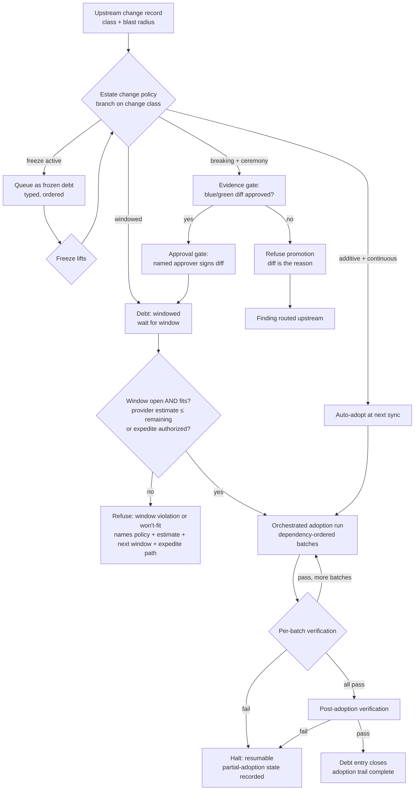

# Change-control adoption — the stage

**What this settles:** the operational flow that carries an upstream class change into an
estate under that estate's own change-management policy: who decides, what gates, and when
things actually move. The mechanics of *what* changes are settled elsewhere (ADR-045: atomic
recompilation, pins, visible debt), and the evidence standard by ADR-046 (the blue/green
typed-output diff). This flow is the calendar and the ceremony around them. It builds on
[request-realization](request-realization.md). The new twist is that the "request" is the
estate's own decision to move forward in time.

> **Use Cases:** `change-control/additive-auto-adopted-continuous`,
> `additive-deferred-to-window`, `breaking-full-ceremony`, `out-of-window-refused`,
> `staged-rollout-tiers`, `expedite-break-glass`, `freeze-queues-adoptions`,
> `intra-estate-ordered-propagation`.
> **Persona:** platform-engineer · **Profiles:** dev / prod / fsi (the regimes vary by profile).

**In one breath.** An upstream change arrives already classified (additive or breaking) with
its blast radius computed. The estate's change policy, a declared artifact and not a wiki page,
branches on that class and decides the ceremony: adopt automatically, wait for a window, or run
the full evidence-approval-window-verify sequence. Waiting is always visible as typed debt
(queued, windowed, frozen). Scheduling gates decide *when* but never *whether*; no clause can
waive blue/green evidence for a breaking change. The adoption itself propagates through
downstream records in dependency-derived order, batch by verified batch, leaving one recorded
trail from classification to closed debt.

## The flow — only what's different

## What informs each decision — the model surfaces

Each decision node reads a named UDLM surface. The table names the file that carries each one.
The **policy role** column states whether a policy *decides* (gates, refuses, selects) or
*enriches* (adds data other steps read) at that node, and which `policy_type` from the policy
schema's vocabulary carries it.

| Decision / step | Model surface read | Where it lives | Policy role — decides or enriches what |
|---|---|---|---|
| Change classified additive/breaking | the upstream change record's `classification` | `registry/regeneration-manifest.schema.json` (the durable change record, ADR-045) | Enriches (`transformation`): stamps the change class every later gate branches on |
| Blast radius known | the class graph plus the consumer manifests | `registry/class.schema.json` and `registry/tools/generate_class_specs.py`; `registry/consumers/` (register row 044); the manifest's `affected_artifacts` and `consumer_debt` | Enriches: attaches the affected-artifact set to the change record |
| Adoption mode chosen per class | the estate's change policy (`policy_type: validation` or `orchestration_flow`) with its `schedule` clauses | `registry/policy.schema.json` (`schedule[].kind`: `window`, `freeze`, `expedite`, `precondition`; ADR-053) | Decides: automatic vs windowed vs full ceremony |
| Freeze suspends adoption | a dated `freeze` clause, which queues rather than runs | `registry/policy.schema.json` (`schedule`) | Decides: refuse-and-queue vs proceed |
| Evidence gate | the blue/green typed-output diff record | `registry/promotion-evidence.schema.json` (ADR-046) | Decides (`validation`): promotion may proceed only on a clean or approved diff |
| Approval gate | a named approver's sign-off, bound to the digest of the evidence it accepts | `registry/policy.schema.json` (`schedule[].approval`: `approver`, `accepts_digest`, `at`, `authority_level`) | Decides (`override`-class): a human authority accepts the evidence |
| Window gate | a `window` clause, an `expedite` clause, or a calendar the policy names by reference (`calendar_ref`) and an information provider serves; authority declared per scope; stale knowledge fails closed (docs/design/change-control-knowledge-sources.md, UC 013–015) | `registry/policy.schema.json` (`schedule`); `registry/examples/example-policy-change-window.yaml` | Decides: execute now, defer, or expedite under elevated approval |
| Propagation order | the entity's `dependencies[]` edges (state records): `edge_type` and its ordering semantics | `registry/state-record.schema.json`; the shutdown-order machinery's own surface | Enriches: derives batch order; no policy overrides structure |
| Batch verification | target types' declared outputs vs realized values | each class's `outputs` ([D8.3]; per-type adequacy varies) | Decides (`validation`): batch passes or propagation halts |
| Debt states (windowed, queued, frozen) | typed debt, derived from the schedule clauses and never stored: `pin_behind`, `windowed`, `frozen` | `registry/policy.schema.json` (`schedule`, ADR-053) | Enriches: makes waiting legible and auditable |
| Adoption trail | audit records | `registry/audit-record.schema.json` | Enriches: the reconstructible history every retrospective reads |

Every surface this flow reads has a home in the registry today: the graph, the outputs, the
policy clauses, the two record shapes (change record, evidence record), and the audit
substrate.

## The invariants

- **The policy is data.** Adoption mode, gates, windows, freezes, and expedite paths are
  clauses of a declared policy object the orchestration evaluates — never tribal process. The
  human decision is made once, in the policy, not once per change.
- **A window must *fit*, not just be open.** The provider gives an implementation time-to-complete
  estimate (its own duration is provider_specific). The window gate proceeds only if
  `estimate + margin ≤ window_remaining`. A 2-hour window cannot hold a 4-hour implementation. A
  job that won't finish is not started; it defers, batch-fits, or expedites (ADR-053 ruling 8; the
  estimate reuses the RTO and T6 validated-time-bound machinery).
- **Scheduling gates control when; evidence gates control whether.** An expedite clause
  compresses the calendar under elevated approval and a flagged audit record; nothing waives
  the evidence gate. There is no path to a promoted breaking change without its diff.
- **Waiting is visible and typed.** Queued (freeze), windowed (scheduled), and ordinary
  pin-behind lag are distinct debt states. An estate that is behind is provably on-policy
  behind.
- **Propagation is ordered and resumable.** Downstream updates run in dependency-derived
  order, in batches, each verified before the next; failure halts with a recorded,
  resumable state. A fleet is never rewritten unordered.
- **Chains are declared, not scripted.** Multi-estate rollout is each stage's policy naming
  its predecessor's evidence as a precondition; a stage failure halts every later stage by
  construction.

## What UDLM does not decide

Who executes the orchestrated adoption run and how it schedules. That is the control plane's
Process-family concern: the adoption job is automation intent like any other (see
[automation-migration-and-promotion](automation-migration-and-promotion.md)). UDLM defines the
policy clause vocabulary, the debt states, the evidence records, and the trail. The control plane
evaluates and runs them.

## Data · Policy · Provider (required lens — SPEC-DESIGN §29)

- **Data:** the upstream change record (classification + blast radius), the typed debt states,
  the blue/green diff, the adoption trail.
- **Policy:** the change-management policy's clauses — adoption mode per change class, window,
  freeze, expedite, precondition-on-evidence — and the refusals they produce.
- **Provider:** the orchestrated adoption run (a Process-family job) executing
  dependency-ordered, batch-verified propagation under the policy's gates.

## Where each piece is specified

| Piece | Contract |
|---|---|
| Change classification, pins, debt | ADR-045 (class evolution and pinning) |
| Evidence, promotion, refusal routing | ADR-046 (blue/green promotion contract) |
| Policy clause vocabulary, debt states | [ADR-053](../adr/ADR-053-change-control-policy-vocabulary.md) (accepted; realized by `registry/policy.schema.json` `schedule`) |
| Corpus cases | `use-cases/change-control/` (ride every analysis run) |
| Worked example (three regimes) | `docs/examples/change-control-walkthrough.md` |
