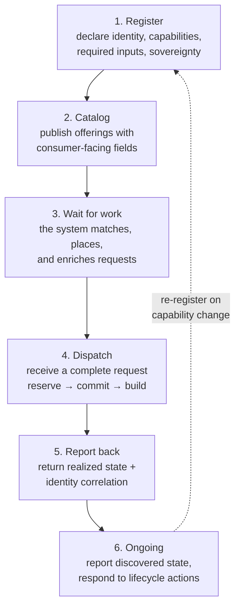
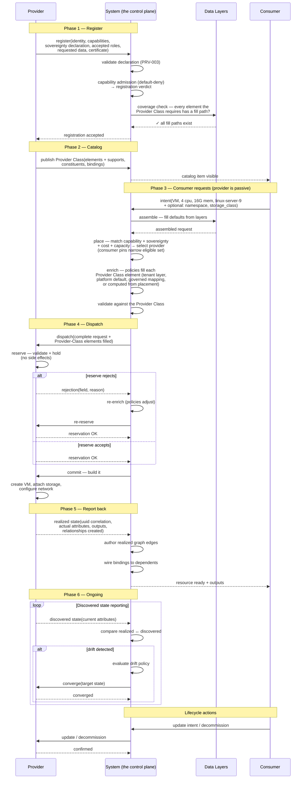

# Provider lifecycle — from the provider's perspective

**What this settles:** the complete journey a provider takes, from declaring what it can do, through
receiving and fulfilling requests, to reporting back what it built. This is the **provider's view** of the
system: what it must do at each stage, what data it supplies, and what it gets back. The companion
[request-realization](request-realization.md) tells the same story from the request's perspective; this
document tells it from the provider's.

**In one breath.** A provider registers and declares "I can realize VMs on a Kubernetes cluster". Its
Provider Class says "I need a namespace and a storage class to do it", and lists the values it offers. A
consumer asks for a VM. The system picks this provider, fills in the namespace from governed data, and
hands the provider a complete request. The provider reserves, commits, builds the VM, and reports back what
it did. From then on, it reports discovered state so the system can detect drift. The provider never sees
the portable abstraction layer. It gets a request that already has everything it needs, whether the
consumer or the system supplied each value.

## The lifecycle — six phases



### The full interaction — sequence



---

## Phase 1 — Register: tell the system what you can do

Before receiving any work, a provider registers with the system. Registration is the provider's
**declaration of identity and capability**: everything the system needs to know before it can consider
this provider for placement. Everything in it is a claim or evidence. The system checks it and writes its
own record, the registration verdict (`registry/registration-verdict.schema.json`), which carries the
trust posture, the admitted capabilities and the lifecycle state. A provider cannot set those.

**What the provider supplies:**

| What | Why | Where it's specified |
|------|-----|---------------------|
| Identity: `uuid`, `handle`, `version`, `health_endpoint`, and a `certificate` (its mTLS identity) | The system needs to reach you, know you're alive, and verify who you are | `provider-contract.md` §2, §3, §5 |
| Capabilities: each a verb and domain, such as `realize_resources/Machine` (ADR-PROV-002) | The system matches requests to providers who declared the capability; admission decides which are usable | `provider-contract.md` §8, §9 |
| A `sovereignty_declaration`: jurisdictions, residency zones, sub-processors, audit rights | The system enforces sovereignty constraints at placement | `provider-contract.md` §2, §2a (`SOV-*`) |
| `accepts_roles`: the data roles it will take (`execution`, `assembly`) | Dispatch sends the provider nothing beyond the roles it accepts; the list only narrows | `data-roles.md` |
| `requests_data`: elements it needs beyond its class, each with a reason (PRV-013) | Policy grants, narrows or refuses each request; the grant is recorded on the requested record | `provider-contract.md` §2 |
| Network reachability and telemetry | The platform provisions connectivity from the declaration; telemetry says what it can report | `provider-contract.md` §7 |

The provider-specific inputs a resource type needs (`namespace`, `storage_class`) are **not** in the
registration. They are elements of the provider's **Provider Class** (ADR-038), declared and versioned
with the class (`registry/class.schema.json`), and the class says which values the provider offers for
each (`supports`). Capacity is advertised separately (§8.1a); without it, placement is capability-match
only.

**Example — a Kubernetes VM provider registering** (the control plane answers it with a verdict;
`registry/examples/example-registration-verdict.yaml` is one):

```yaml
record_type: provider_registration
uuid: 3f8b1d40-72c6-4a19-9e05-8d24b1706fa3
conforms_to: udlm/0.1
handle: cexample/compute/k8s-prod-east
version: 1.2.0
display_name: Kubernetes, prod east
description: Realizes VMs and containers on one production Kubernetes cluster.

capabilities:
  - realize_resources/Machine
  - realize_resources/Container

sovereignty_declaration:
  operating_jurisdictions: [US]
  data_residency_zones: [us-east-1]
  enforcement_plane: both
  data_residency_guarantee: true

accepts_roles: [execution]

requests_data:
  - path: placement.location_ref
    reason: Pins the VM to the zone the estate chose; the provider cannot derive it.

health_endpoint: https://k8s-prod-east.example/healthz
certificate:
  pem: |
    -----BEGIN CERTIFICATE-----
    (provider leaf certificate)
    -----END CERTIFICATE-----
  ca_chain: |
    -----BEGIN CERTIFICATE-----
    (estate intermediate CA)
    -----END CERTIFICATE-----
  rotation_interval: P90D
```

An enterprise-virtualization provider realizing the same resource type would register the same way. The
difference sits on its Provider Class: it declares `cluster`, `datastore` and `resource_pool` elements
where the Kubernetes provider's class declares `namespace` and `storage_class`. Same portable type,
different provider elements. The system knows both classes and can fill each one after placement selects
a specific provider.

**What happens at registration:**
- The system validates the declaration (PRV-003: capabilities not declared at registration cannot be invoked later)
- Capability admission runs, default-deny: a platform admin must admit each capability before it's usable (§2, `capability_admissions`; ADR-PROV-003). The result is the registration verdict
- A coverage check verifies every element the Provider Class requires has a fill path (layering-and-versioning §1b). The provider declares what it needs; policies determine where each value comes from (consumer-supplied, tenant layer, platform default, or computed at placement time). Gaps are caught at registration, not on a user's first request

---

## Phase 2 — Catalog: publish what consumers can order

After registration, the provider publishes what consumers can order. A **catalog item is a Provider
Class** (`registry/composition.schema.json`; ADR-038): a consumable class the provider defines, either a
single resource type or a template. The control plane renders it as the menu a consumer browses; the
class is declared once and projected twice (registration presents it, the catalog offers it).

**What the provider supplies:**

| What | Why |
|------|-----|
| The parent type and the class version | Which portable type this offering realizes |
| Elements, each with `supports` | What the consumer may choose, and the values the provider offers for it (a single value, a list, or a range, optionally conditional on another element) |
| Constituents with `depends_on` and `spec_defaults` (templates only) | How a multi-tier offering decomposes, in what order, and what each part defaults to |
| Bindings (templates only) | How one constituent's output wires into another's input |

### Simple catalog item — a VM

Continuing the VM example from Phase 1. The Kubernetes VM provider publishes a Provider Class for a
single virtual machine. The sketch shows the parts that matter here; a complete class carries the
identity and metadata `registry/class.schema.json` requires.

```yaml
record_type: class
class: provider
resource_type: Machine.VM.K8sProdEast
parent: Machine.VM
version: 1.0.0

elements:
  - element: namespace
    scope: Machine.VM.K8sProdEast
    optional: true
    schema:
      type: string
      format: udlm-ref-url            # a reference to a KubernetesNamespace, not a free-form string
    supports:
      - values: [tenant-alpha-prod, tenant-alpha-staging, shared-workloads]
  - element: storage_class
    scope: Machine.VM.K8sProdEast
    optional: true
    schema:
      type: string
      format: udlm-ref-url            # a reference to a StorageClass
    supports:
      - values: [ceph-rbd-fast, ceph-fs-standard, local-nvme]
```

The consumer sees the portable elements (`cpu`, `memory`, `guest_os`, `disks`, `networks`) as the primary
choices. `namespace` and `storage_class` are visible but optional. The consumer MAY specify them if they
know what they want: honored, validated, and flagged as non-portable in the realized record's
`portability` block. If omitted, policies resolve them after placement. The class declares *what* the
provider needs and *which values* it offers; whether the consumer is asked follows from that (see the
fill-strategy section below).

Note the **element itself is a reference**, not free-form text: `namespace` and `storage_class` are
`udlm-ref-url` values pointing at `KubernetesNamespace` and `StorageClass` records. That is the same shape
used in the dispatch payload (Phase 4) and the "References, not strings" principle. It lets the element be
presented as a drop-down of real, tenant-visible records and validated as a graph edge, rather than a
string typed from memory. An element is free-form text only when its value is *not* a resource with
identity and lifecycle.

### Composite catalog item — a three-tier application

A provider that offers a complete application stack publishes a template class. The composite
decomposes into constituents with dependency ordering and output bindings. The worked class is
`registry/classes/resource/services/template/application/acme-three-tier.yaml`; its constituents are:

```yaml
record_type: class
class: provider
resource_type: Template.Application.AcmeThreeTier
parent: Template.Application
composition_visibility: transparent

constituents:
  - component_id: db
    resource_type: Database
    provided_by: external
    failure_effect: required
    edge_type: contained_by
    spec_defaults:
      engine: postgresql
  - component_id: app
    resource_type: Container
    provided_by: external
    failure_effect: required
    edge_type: contained_by
    depends_on: [db]
    bindings:
      - from_component: db
        output: connection_string
        to_field: env.DATABASE_URL
  - component_id: web
    resource_type: Container
    provided_by: external
    failure_effect: required
    edge_type: contained_by
    depends_on: [app]

elements:
  - element: tier_size          # small | medium | large; the sizing is the consumer's to choose
  - element: database_capacity  # offered per tier_size, through `supports ... when`
  - element: exposure           # internal | private_network
```

The system decomposes this into three separate requests dispatched in dependency order (db → app →
web). Each constituent goes through the same placement → enrichment → reserve → commit cycle described
in Phases 3–4. The `bindings` wire outputs from one constituent into the next: the database's
`connection_string` output feeds the app's `env.DATABASE_URL` input automatically.

For the composite, the consumer sees only the class's own elements (`tier_size`, `database_capacity`,
`exposure`). They don't manage the individual constituents or their wiring. Provider-specific values for
each constituent (which namespace the containers land in, which storage class the database uses) are
resolved per constituent by the same policy-driven enrichment as a simple request.

---

## Single-stage vs two-stage intent

Provider-specific fields (namespace, storage class, node pool) can reach the request at two different
moments. Both are valid; the consumer's situation and the organization's policy determine which
applies.

### Single-stage intent

The consumer supplies everything, portable fields and provider_specific fields, in one submission.
The catalog UI shows all fields upfront, with provider_specific fields clearly marked as optional
and as narrowing placement. This works for power users who know their environment, scripted and API
consumers, and IaC pipelines where the provider is already known.

```
┌─────────────────────────────────────────────────────────────┐
│  Request a VM                                               │
│                                                             │
│  ── Portable fields ──────────────────────────────────────  │
│  CPU        [ 4        ]                                    │
│  Memory     [ 16 GiB   ]                                    │
│  Guest OS   [ Linux 9  ▼]                                   │
│  Network    [ prod-vlan-40 ▼]                                │
│  Disk       [ 100 GB SSD   ]                                │
│                                                             │
│  ── Provider-specific (optional) ─────────────────────────  │
│  ⚠ Specifying these narrows placement and may break         │
│    portability                                              │
│                                                             │
│  ▸ Kubernetes                                               │
│    Namespace      [ tenant-alpha-prod ▼]                     │
│    Storage class  [ ceph-rbd-fast     ▼]                     │
│                                                             │
│  ▸ Enterprise virt                                          │
│    Cluster        [                   ▼]                     │
│    Datastore      [                   ▼]                     │
│    Resource pool  [                   ▼]                     │
│                                                             │
│  ▸ Libvirt                                                  │
│    Host           [                   ▼]                     │
│    Storage pool   [                   ▼]                     │
│                                                             │
│                                    [ Submit ]               │
└─────────────────────────────────────────────────────────────┘
```

The provider_specific sections are **grouped by provider** and collapsed by default (the ▸
disclosure). Expanding a provider group and filling a field narrows placement to that provider.
Filling fields in two provider groups is a contradiction, and the UI prevents it (expanding one
collapses the others, or a radio-select at the group level picks the target provider). Drop-downs
are populated from the provider's registered resources: namespaces from `KubernetesNamespace`
records the consumer's tenant has access to, storage classes from `StorageClass` records
on the selected cluster.

### Two-stage intent

The consumer submits portable intent only. The system runs placement and selects a provider. Then
the system comes back with the provider_specific fields that still need values, pre-populated with
valid options the consumer can choose from, or defaults to accept. This is the natural model for GUI
portal users, first-time users, and compliance-heavy environments where the system should show what's
allowed.

**Stage 1 — portable intent:**

```
┌─────────────────────────────────────────────────────────────┐
│  Request a VM                                               │
│                                                             │
│  CPU        [ 4        ]                                    │
│  Memory     [ 16 GiB   ]                                    │
│  Guest OS   [ Linux 9  ▼]                                   │
│  Network    [ prod-vlan-40 ▼]                                │
│  Disk       [ 100 GB SSD   ]                                │
│                                                             │
│                                    [ Continue → ]           │
└─────────────────────────────────────────────────────────────┘
```

**System runs placement → selects the Kubernetes provider (k8s-prod-east)**

**Stage 2 — provider_specific refinement:**

```
┌─────────────────────────────────────────────────────────────┐
│  Provider selected: Kubernetes (k8s-prod-east)              │
│  Region: us-east-1 · Profile: fsi                           │
│                                                             │
│  The following fields are needed to complete your request.   │
│  Defaults have been selected by policy — change if needed.  │
│                                                             │
│  Namespace      [ tenant-alpha-prod ▼]  ← policy default    │
│                   tenant-alpha-prod                          │
│                   tenant-alpha-staging                       │
│                   shared-workloads                           │
│                                                             │
│  Storage class  [ ceph-rbd-fast     ▼]  ← policy default    │
│                   ceph-rbd-fast (block, 10K IOPS, encrypted) │
│                   ceph-fs-standard (file, 1K IOPS)          │
│                   local-nvme (local, 50K IOPS, no repl)     │
│                                                             │
│  Node pool      [ general-purpose   ▼]  ← auto (no GPU req) │
│                   general-purpose (x86_64, 340 vCPU avail)  │
│                   gpu-pool (x86_64, 8 GPUs, 12 vCPU avail) │
│                                                             │
│                          [ ← Back ]  [ Submit ]             │
└─────────────────────────────────────────────────────────────┘
```

Key UX principles for Stage 2:

- **Drop-downs, not free text.** Every provider_specific field is populated from the provider's
  registered resources (KubernetesNamespace, StorageClass, KubernetesNodePool), filtered to
  what the consumer's tenant has access to. The consumer picks from valid options, not from memory.
- **Policy defaults pre-selected.** The enrichment policy selects a default before the consumer
  sees the form. The consumer can change it, but the happy path is "accept and submit."
- **Context on each option.** Drop-down items show relevant attributes: a storage class shows IOPS,
  encryption and replication; a node pool shows architecture, GPU and available capacity; a namespace
  shows its tenant binding. The consumer makes an informed choice without looking it up elsewhere.
- **Provider grouping.** If multiple providers were eligible and the system picked one, the Stage 2
  form shows which provider was selected and why (cost, sovereignty, capacity). A "choose a
  different provider" link re-runs placement with the consumer's override.
- **Back button preserves intent.** Going back to Stage 1 keeps the portable fields and re-runs
  placement (the consumer can change constraints and get a different provider).

### Fill strategy per field — derived, not declared

How a Provider Class element gets filled is read from the element's `supports` declaration and the
governed data, not stored as a per-field setting (the field-earns-its-place rule). The same
three behaviours fall out of the facts:

| What the facts say | Behaviour |
|---|---|
| `supports` offers one value, or governed data fixes it | filled silently; the consumer never sees the field |
| `supports` offers a range or a list and nothing fixes it | the consumer is shown the options and chooses |
| `supports` offers a range or a list and governed data supplies a default | filled with the default; the consumer may change it before reserve |

Nothing to declare, nothing to drift: when a provider widens or narrows what it supports, the
behaviour follows.

---

## Phase 3 — Wait: the system does the matching

The provider does nothing in this phase. The system handles:

1. **Intent** — a consumer submits a request. In single-stage, it may include provider_specific
   fields. In two-stage, it contains only portable fields. Either way, the flow proceeds the same.
2. **Assembly** — data layers fill in defaults (profile, tenant, platform layers)
3. **Placement** — policies narrow to eligible providers based on capability match, sovereignty,
   cost, capacity, and consumer constraints. If the consumer pinned provider_specific fields, only
   providers that accept those values are eligible.
4. **Enrichment** — policies determine how to fill any Provider Class element the consumer did not
   already supply. Per element, the behaviour follows from `supports` and the governed data (the
   fill-strategy table above): filled silently, shown as a choice, or filled with a default the
   consumer may change. If any element is left for the consumer, the system pauses after enrichment
   and presents the Stage 2 form before proceeding to validation.
5. **Validation** — the complete request (consumer-supplied, policy-enriched, consumer-refined)
   is checked against the Provider Class. The provider's reserve step (Phase 4) is the final
   validation. If anything is wrong, whoever supplied it, reserve rejects with a field-level error.

The provider's registration (Phase 1) and catalog items (Phase 2) are the inputs the system uses. The
provider is passive until dispatch.

---

## Phase 4 — Dispatch: receive a complete request and build it

The provider receives a **fully enriched request**: the portable base fields plus all provider_specific
elements filled in. It never receives an incomplete request; the system's validation (Phase 3) guarantees
that.

**What the provider receives:**

```yaml
resource_type: Machine.VM
spec:
  cpu: { count: 4 }
  memory: { size: 16Gi }
  guest_os: <reference to a governed os_image term>
  disks:
    - name: os
      size: 100Gi
      role: boot
  networks:
    - name: eth0
      network_ref: uuid/b7e3f1a2-...   # → existing VirtualNetwork
      ip_mode: dynamic
      # RESOLVED, not necessarily stated. The consumer may have written a requirement
      # instead — a zone, a tier, a segment — and placement converged on this network
      # (ADR-036: name-selectable but requirements-authoritative). By dispatch the
      # reference is concrete either way, which is what "fully enriched" means.

# Provider-specific references are Provider-Class `SharedDataElement`s (ADR-038), declared by
# the provider's Class (`registry/class.schema.json`). For k8s-prod-east, addressed
# Machine.VM.K8sProdEast#<element>:
#   namespace     → KubernetesNamespace  "tenant-alpha-prod"  (e2f3a4b5-...)
#   storage_class → StorageClass         "ceph-rbd-fast"      (c6d7e8f9-...)

request_context:
  tenant_uuid: "75ccf4ff-..."
  sovereignty_zone: "us-east-1"
  intent_uuid: "a1b2c3d4-..."
```

### References, not strings

Every field that points at another resource carries a URF reference (identifier-scheme §9): one URL
string whose uuid path resolves the target and whose optional `@pin` names an immutable version.

- `network_ref` → `VirtualNetwork`
- `namespace` → `KubernetesNamespace`
- `storage_class` → `StorageClass`
- `ip_address` → `IPAddress`
- Storage volume attachments → `Volume`

**The principle:** if something has identity and lifecycle, and other resources depend on it, it's a
resource type in the registry and gets a reference, not a bare string. A bare string is opaque to the
system: it can't be queried by policies, it can't be drift-detected, and impact analysis can't trace
through it. A reference is a graph edge the system can walk.

References are version-pinned on the URL's `@pin` axis; each version is a new immutable record with its
own identity uuid (the ADR-051 family rule). But the referenced resource's **handle** remains stable
across versions, so a consumer or policy can reference "tenant-alpha-prod" by handle and the system
resolves it to the current version.

**What the provider does — two-phase realize:**

1. **Reserve** — validate the request against its own systems and hold resources (capacity, IP, name),
   but create nothing. No side effects. If the request can't be fulfilled, return a clear error
   with the specific field or constraint that failed. The system may loop (re-enrich and re-reserve)
   until the reservation converges.

2. **Commit** — build it. Create the VM, attach the storage, configure the network. This is the
   only step where real infrastructure changes happen.

Both MUST be **idempotent** — the system may re-drive either step on failure or restart.

The reserve step is where the provider validates the complete request against its own requirements.
It does not matter who supplied each value: the consumer, a policy, or a governed layer. If the
provider cannot fulfill the request as assembled, it rejects with a specific reason. The system may
re-enrich (policies adjust values) and re-reserve in a convergence loop, until the request is
satisfiable or the system determines it cannot be fulfilled.

---

## Phase 5 — Report back: tell the system what you built

After commit, the provider reports the **realized state** — the receipt of what was actually created.

That report becomes the entity's **realized record** (`registry/state-record.schema.json`): written once,
by the provider through the system, naming the requested record it realizes. It carries the fields as built,
the outputs other resources bind to, which provider instance built it, its health, and the natural keys a
later discovery sweep will recognize it by. It is never edited. A later change is a new realized record
that names this one as its predecessor. The system authors the dependency edges into it from the
relationships the provider reports.

**What the provider returns:**

| What | Why |
|------|-----|
| Identity correlation (`udlm_uuid` ↔ provider-native id) | The system tracks the resource across both worlds |
| Realized attributes (actual CPU, memory, IP, FQDN, storage path) | The system records what was delivered vs what was requested |
| Outputs (connection strings, endpoints, DNS names) | Downstream constituents bind to these via the catalog item's `bindings` |
| Relationships created (storage attached, network assigned) | The system builds the realized dependency graph from these |

**Example — realized state report:**

```yaml
udlm_uuid: "a1b2c3d4-..."
provider_native_id: "k8s-prod-east/tenant-alpha-prod/vm-0042"
status: active

realized:
  cpu: { count: 4 }
  memory: { size: 16Gi }
  fqdn: "vm-0042.tenant-alpha-prod.k8s-east.example"
  ip_address: uuid/c9d4e5f6-...         # → realized IPAddress
  storage_path: "/dev/rbd0"

outputs:
  internal_dns: "vm-0042.tenant-alpha-prod.k8s-east.example"
  ssh_endpoint: "192.0.2.42:22"

relationships_created:
  # the disk's Volume is not listed here: the volume declares `realizes_disk` to this machine on its
  # own record (the consumer-declares rule), joining on its `disk_entry`
  - edge_type: binds_to
    relation: network_attachment
    target_type: VirtualNetwork
    target_ref: uuid/b7e3f1a2-...        # → same VirtualNetwork from intent
    target_native_id: "vlan-40"
```

Relationships use the same reference pattern: `target_ref` points at the UDLM resource by UUID, and
`target_native_id` carries the provider's native identifier for correlation. The system can walk
references in either direction (UDLM UUID ↔ provider native ID) because both are recorded.

The system authors the realized relationships from this report. The provider supplies the
correlation; the system sets the edges in the graph.

---

## Phase 6 — Ongoing: keep the system informed

After implementation, the provider has ongoing obligations:

**Discovered-state reporting.** Periodically, or on change, report the current state of every resource
the provider manages. Each report is a **discovered record**: what is there right now, and which keys
matched it to the entity. The system compares the newest discovered record against the newest realized
record; a mismatch is drift. Drift is that comparison, computed when asked, never a field stored on a
record. Policies determine the response (alert, re-converge, or escalate).

**Lifecycle actions.** Respond to system-driven lifecycle actions:
- **Converge** — the system asks the provider to bring a drifted resource back to its intended state
- **Update** — a consumer changes their intent; the system re-enriches and dispatches the delta
- **Scale** — increase or decrease a resource's capacity
- **Decommission** — tear down the resource and confirm removal

**Re-registration.** If the provider's capabilities change (new resource types, a changed Provider Class,
new sovereignty zones), it re-registers as a new version. The coverage check runs again to verify fill
paths.

---

## The full chain — one picture

```
Provider                          System                           Consumer
────────                          ──────                           ────────
1. Register
   → capabilities
   → sovereignty declaration
   → accepted roles, requested data
   → certificate
                                  ← admit capabilities (verdict)
                                  ← verify fill paths

2. Publish Provider Classes
   → elements + supports
   → constituents + spec_defaults
   → bindings
                                  ← catalog visible to consumers
                                                                   Browse catalog
                                                                   Submit intent
                                                                   (may include provider-
                                                                    specific fields — optional)
                                  Assemble (layers)
                                  Place (match + select;
                                    consumer pins narrow the field)
                                  Enrich (fill any class elements
                                    the consumer didn't supply)
                                  Validate (against the Provider Class)

3. (passive)

4. Receive dispatch
   ← complete request
   → reserve (validate + hold)
   → commit (build)

5. Report realized state
   → identity correlation
   → realized attributes
   → outputs
   → relationships
                                  Author realized graph
                                  Wire bindings to dependents
                                                                   See result

6. Ongoing
   → discovered state (periodic)
                                  Compare realized ↔ discovered
                                  Detect drift → policy response
   ← converge / update / decommission
   → confirm action
```

---

## Pointers

- The request's perspective on the same flow: [request-realization](request-realization.md)
- Provider base contract (what you MUST implement): `docs/spec/contracts/provider-contract.md` §1a
- Registration and the verdict: `docs/spec/contracts/provider-contract.md` §2; `registry/registration-verdict.schema.json`
- Capability advertisement shape: `docs/spec/contracts/provider-contract.md` §8 (capabilities) and §10 (discovery protocol)
- How provider elements get filled: [request-realization, "Where the value comes from"](request-realization.md#where-the-value-comes-from); `docs/spec/foundations/layering-and-versioning.md` §1b
- Policy contract (enrichment policies): `docs/spec/contracts/policy-contract.md` §12
- Composition shape (what a catalog item carries): `registry/composition.schema.json`; the class meta-schema: `registry/class.schema.json`
- Provider-specific data model: UDLM ADR-038 (Provider-Class `SharedDataElement`s); portability: the realized record's `portability` block (`registry/state-record.schema.json`)
- Per-state records: `registry/state-record.schema.json`; the merged read model: `registry/entity-view.schema.json`
- Provider registration UC: [UC-17](uc-17-provider-registration-capability.md)
