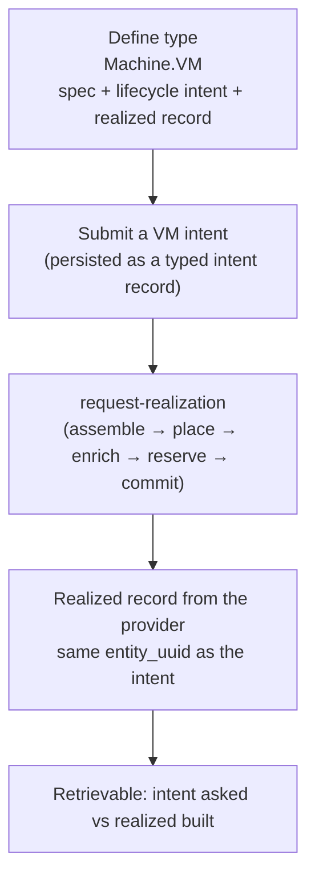

# UC-01 · VM as a first-class UDLM resource — the stage

**What this settles:** what the `Machine.VM` type itself is made of: the spec a user submits, the lifecycle intent, and the realized facts the provider hands back. A VM is then a typed, retrievable resource, not a bag of provider fields. A **lighter** flow: it **builds on [request-realization](request-realization.md)** and documents only what this case adds.

> **Use Case:** `compute/vm-resource-representation`. **Persona:** platform-operator · **Profile:** standard.

**In one breath.** request-realization shows how a VM *request* gets built. This case is one level earlier: it defines the VM type that request is an instance of. A `Machine.VM` carries a portable **spec** (placement, cpu and memory, storage, networks) and a **lifecycle intent** (the desired `run_state`). Once realized, the provider's facts land in a **realized record** that shares the entity's identity with the intent record. Intent and reality are two records of one entity, typed by the same class, so they compare field by field.

## What this adds over request-realization

- **The type, not just a request of it.** request-realization assumes `Machine.VM` exists; here the platform-operator *defines* it: its spec fields and the shape of its realized record.
- **Spec and realized record, one entity.** Spec is what was asked (the portable base; [ADR-016](../adr/ADR-016-resource-type-role-graph-audit-not-config.md): the type is the audit surface, not configuration). The realized record is what the provider built. Both carry the same `entity_uuid`, so they can be compared.
- **Realized facts are reconciled from the provider.** The provider reports native facts (assigned host, disk paths, power state). They land in the realized record: the [four-states](../spec/foundations/four-states.md) Realized side, made concrete for a VM. That record is consumable on its own, without the intent record present.

## The flow — only what's different

Everything between Submit and Realized is request-realization.

## Success criteria (from the UC)

- `Machine.VM` declares a spec (placement requirements, resources, storage, networks) and a lifecycle intent as typed fields, not free-form provider attributes.
- A submitted VM intent is persisted as an intent record and is retrievable as a typed resource.
- The provider's realized facts (host, disk paths, power state) are reconciled into a realized record that shares the entity's identity with the intent record.
- Intent and realized records can be compared field by field, because both are typed by the same class.
- The realized record is consumable on its own, without the intent record present.

## Data · Policy · Provider

- **Data:** the `Machine.VM` class (portable spec, `run_state` as the lifecycle intent) and the two records it types: the intent record and the realized record, one `entity_uuid`.
- **Policy:** system defaults only here (`system_defaults_only`); enrichment and placement are request-realization's job.
- **Provider:** the compute provider realizes the VM and reports its facts; they are reconciled into the realized record.

## Who provides what, and when

The lifecycle answer — the personas, what a request contains, what data is added and **by whom**, why
**nobody sets placement**, and the worked VM-with-network-and-storage example — lives once in
[request-realization § Who provides what, and when](request-realization.md#who-provides-what-and-when).
It holds for every use case.

**This case's delta:** the driving persona is **`platform-operator`**. Everything that persona relies on —
layers, tenant binding, policies, provider capability — was declared by the others *before* this
request existed, exactly as the lifecycle answer describes.

## Pointers

- Base flow: [request-realization](request-realization.md). UC source: `compute/vm-resource-representation`.
- The four states (Intent, Requested, Realized, Discovered) and one record per state (§2.7): [`docs/spec/foundations/four-states.md`](../spec/foundations/four-states.md).
