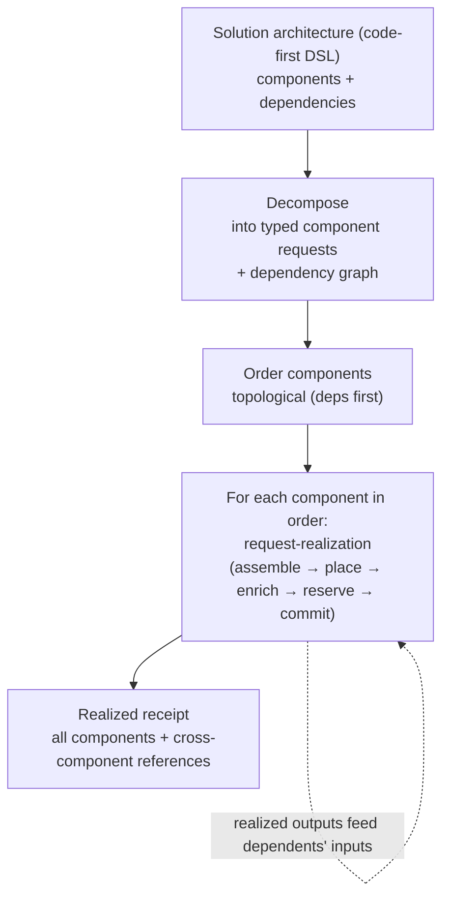

# UC-02 · Architectural pattern to composite request — the stage

**What this settles:** how a whole **solution**, a multi-component architecture, becomes many typed resource requests with the dependency edges between them preserved. Components deploy in dependency order, each enriched and placed on its own, and the result is portable: nothing in it names a provider's native form. A **lighter** flow: it **builds on [request-realization](request-realization.md)** and documents only what this case adds, the **decompose-and-orchestrate** wrapper around it.

> **Use Case:** `architecture/solution-architecture-decomposition`. **Persona:** solution-architect · **Profile:** standard.

**In one breath.** request-realization builds *one* resource. A solution architecture describes *many*: a database, an app tier, a load balancer, and the links between them. This case decomposes that architecture (written in a code-first DSL) into per-component requests with their dependency edges, and runs each component through request-realization **in order**. A component that depends on another waits for the reference it needs (the database's address, the network's id). Providers can differ per component (`multiple_eligible`). When the graph is fully realized, one receipt records every component, its realized state, and the cross-component references that wire them together.

## What this adds over request-realization

- **A composite, decomposed.** The unit of intent is a **solution**, not a resource. Decomposition turns the architecture into a set of typed component requests plus the edges between them (resource complexity `full_stack`).
- **Dependency-ordered orchestration.** Components realize in topological order; a dependent component's request is only assembled once its upstreams have produced the references it consumes. The graph the architect drew is the graph the platform orders against.
- **Each component is still a normal request.** Every node runs the full assemble → place → enrich → reserve → commit underneath, including its own base engineering pattern plus the architect's customizations. Nothing about the single-resource contract changes.
- **Portable by construction.** Nothing in the decomposition names a provider's native form, so the same decomposition is eligible to place onto any provider that satisfies its requirements.
- **Cross-component references in the receipt.** The realized receipt is not N independent records. It captures the **wiring**, which component's realized output feeds which component's input, so the solution can be understood and later rehydrated as a whole.

## The flow — only what's different

Each component's own build is request-realization; decompose, order, and the wiring receipt are this case.

## Success criteria (from the UC)

- The architecture decomposes into typed resources, each with its declared dependency edges.
- The dependency structure the architect drew is the graph the platform orders realization against.
- The decomposition is portable: nothing in it names a provider's native form.
- The same decomposition is eligible to place onto any provider that satisfies the requirements.
- The whole is realized as an ordered, dependency-aware set, not a flat list.

## Data · Policy · Provider

- **Data:** the solution as a graph of typed component requests and their dependency edges; the realized receipt binding component outputs to dependents' inputs.
- **Policy:** a chain of policies across the components (`multi_policy_chain`) under standard governance, plus each component's own placement and enrichment; the ordering is static, derived from the graph.
- **Provider:** potentially many; each component may land on a different eligible provider (`multiple_eligible`).

## Who provides what, and when

The lifecycle answer — the personas, what a request contains, what data is added and **by whom**, why
**nobody sets placement**, and the worked VM-with-network-and-storage example — lives once in
[request-realization § Who provides what, and when](request-realization.md#who-provides-what-and-when).
It holds for every use case.

**This case's delta:** the driving persona is **`solution-architect`**. Everything that persona relies on —
layers, tenant binding, policies, provider capability — was declared by the others *before* this
request existed, exactly as the lifecycle answer describes.

## Pointers

- Base flow (per component): [request-realization](request-realization.md). UC source: `architecture/solution-architecture-decomposition`.
- The four states (each component realizes independently): [`docs/spec/foundations/four-states.md`](../spec/foundations/four-states.md).
