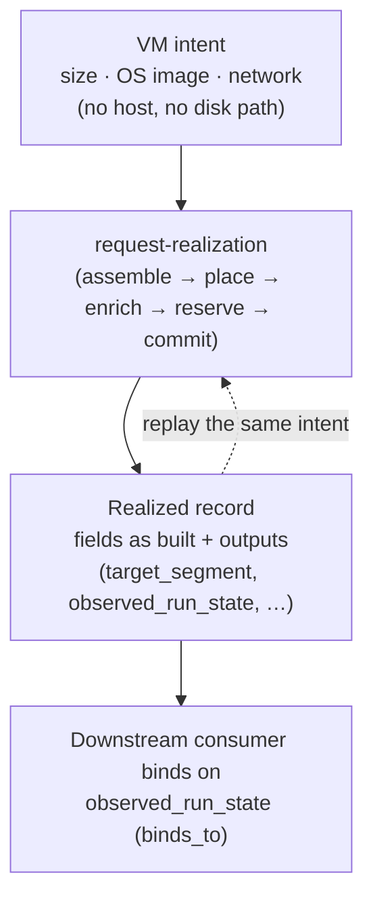

# UC-03 · Standard VM provision — the stage

**What this settles:** the plainest provision there is. A platform engineer asks for a `Machine.VM` by intent alone: a size, an OS image, and the network it attaches to. No hypervisor host, disk path or provider-native placement is named. The provider realizes it, and what was built is read from the VM's record and its declared **outputs**, not from the hypervisor. A **lighter** flow: it **builds on [request-realization](request-realization.md)** and documents only what this case adds.

> **Use Case:** `compute/provision-vm-standard`. **Persona:** platform-engineer · **Profile:** standard.

**In one breath.** The request carries vCPU and memory, an OS image, and a network attachment. The compute provider selects an eligible backend, builds the VM to that size on that image, attaches the network, and the VM reaches Realized. Its assigned size, image, network attachment and power state are readable from the realized record. A downstream consumer binds on the power-state output, contract-checked, instead of polling the hypervisor. Rehydration is the same intent replayed against an eligible provider.

## What this adds over request-realization
- **Nothing new about assembly or placement.** Standard profile, one eligible provider (`single_eligible`): placement has one candidate and enrichment fills the provider's required fields as always.
- **Intent is the build instruction.** The declared size, OS image and network *are* what the provider builds. No host, disk path or native placement leaks into the intent; a `Machine.VM` is portable intent, not a provider-native handle.
- **The record is the read surface.** The realized record carries the fields as built and the outputs other things bind to (four-states §2.7). The class declares outputs such as `primary_ip`, `hostname`, `target_segment`, `realized_volumes`, `observed_run_state` and `provider_handle`. Nothing is inferred provider-side.
- **Consumers bind on outputs.** Something downstream that needs the VM running binds on `observed_run_state` through a `binds_to` edge, and the contract checks the binding. Nobody polls the hypervisor.
- **Replay is rehydration.** The same intent, replayed against any eligible provider, rebuilds the VM ([four-states §5](../spec/foundations/four-states.md)).

## The flow — only what's different

Everything in the build is request-realization; this case fixes what the intent may contain and what is read back.

## Success criteria (from the UC)
- The request carries the size, OS image, and network attachment from the record alone; no provider-native host or disk path leaks into the intent.
- The provider realizes the VM to the declared size on the declared OS image and attaches the declared network; the VM reaches Realized.
- The assigned size, OS image, network attachment, and power state are readable from the VM's declared outputs, not inferred provider-side.
- A downstream consumer binds on the VM's power-state output, contract-checked, rather than polling the hypervisor.
- The VM rehydrates by replaying the same intent against an eligible provider.

## Data · Policy · Provider
- **Data:** the portable `Machine.VM` intent (`cpu`, `memory`, `guest_os`, `networks`), its realized record, and the outputs other things bind to.
- **Policy:** system defaults only (`system_defaults_only`), evaluated before anything is reserved; no governance overlay in this case.
- **Provider:** the one eligible compute provider builds the VM and reports the realized record with its outputs.

## Who provides what, and when

The lifecycle answer — the personas, what a request contains, what data is added and **by whom**, why
**nobody sets placement**, and the worked VM-with-network-and-storage example — lives once in
[request-realization § Who provides what, and when](request-realization.md#who-provides-what-and-when).
It holds for every use case.

**This case's delta:** the driving persona is **`platform-engineer`**. Everything that persona relies on —
layers, tenant binding, policies, provider capability — was declared by the others *before* this
request existed, exactly as the lifecycle answer describes.

## Pointers
- Base flow: [request-realization](request-realization.md). Re-applying an unchanged intent is a no-op: [UC-13](uc-13-idempotent-reconvergence.md). Rebuild from intent: [UC-10](uc-10-dynamic-rehydration.md).
- UC source: `compute/provision-vm-standard`.
