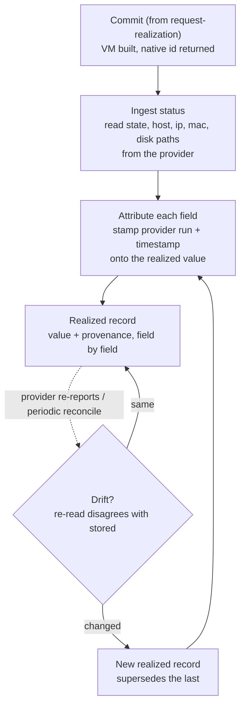

# UC-05 · VM status provenance — the stage

**What this settles:** what happens *after* commit. The provider's reported status (state, host, ip, mac, disk paths) lands on the realized record, and **every realized field carries who produced it, in which run, and when**. When the provider re-reports a changed value, a new realized record supersedes the old one; the field and its provenance advance together. A **lighter** flow: it **builds on [request-realization](request-realization.md)** and documents only what this case adds.

> **Use Case:** `compute/vm-status-provenance`. **Persona:** compliance-auditor · **Profile:** standard.

**In one breath.** request-realization ends at commit with "what was asked and what was built are both stored." This case makes the *built* side auditable. The provider's status is not just written onto the realized record: each field records its origin, which provider run and at what time. When reality drifts, a superseding realized record carries the new value and its new provenance, and the earlier record stays readable. So an auditor can always answer "where did this ip come from, and is it still current?"

## What this adds over request-realization

- **Provenance is per realized field, not per record.** request-realization records origin for *requested* values during enrichment. Here the same discipline extends to the *realized* side: `state`, `host`, `ip`, `mac` and disk paths each carry the run and timestamp that produced them ([ADR-016](../adr/ADR-016-resource-type-role-graph-audit-not-config.md): the type is the audit surface). Unchanged fields keep their original run and time.
- **Status ingest is a first-class step.** Commit hands back native facts once; this case keeps reconciling them as the provider re-reports, so the realized side tracks the running VM.
- **Drift is a superseding record, not a rewrite.** When a re-read disagrees with the stored value (a live migration moved the `host`, DHCP changed the `ip`), a new realized record supersedes the previous one (`supersedes`, [four-states §2.7](../spec/foundations/four-states.md)). The field updates *and* its provenance advances to the new run; the old value and its origin are not overwritten.

## The flow — only what's different

Everything up to Commit is request-realization.

## Success criteria (from the UC)

- Realized status (state, host, ip, mac, disk paths) is read from the provider and stored on the realized record.
- Each realized field carries provenance naming the provider, the run that produced it, and the time.
- A changed value on re-read produces a superseding realized record; the field and its provenance both advance.
- The earlier realized record stays readable, so the previous value and its origin are not overwritten.
- Provenance is per field, not per record; unchanged fields keep their original run and time.

## Data · Policy · Provider

- **Data:** the realized records of a `Machine.VM`, each field paired with its provenance (provider run and timestamp), chained by `supersedes`. This is the [four-states](../spec/foundations/four-states.md) Realized side made auditable.
- **Policy:** system defaults only (`system_defaults_only`); no placement or enrichment logic here. The concern is faithful ingest, not choosing values.
- **Provider:** the compute provider reports native status on commit and on every re-read; each report is a realized record, and a changed one supersedes the last.

## Who provides what, and when

The lifecycle answer — the personas, what a request contains, what data is added and **by whom**, why
**nobody sets placement**, and the worked VM-with-network-and-storage example — lives once in
[request-realization § Who provides what, and when](request-realization.md#who-provides-what-and-when).
It holds for every use case.

**This case's delta:** the driving persona is **`compliance-auditor`**. Everything that persona relies on —
layers, tenant binding, policies, provider capability — was declared by the others *before* this
request existed, exactly as the lifecycle answer describes.

## Pointers

- Base flow: [request-realization](request-realization.md). UC source: `compute/vm-status-provenance`.
- The four states (Intent, Requested, Realized, Discovered) and one record per state (§2.7): [`docs/spec/foundations/four-states.md`](../spec/foundations/four-states.md).
