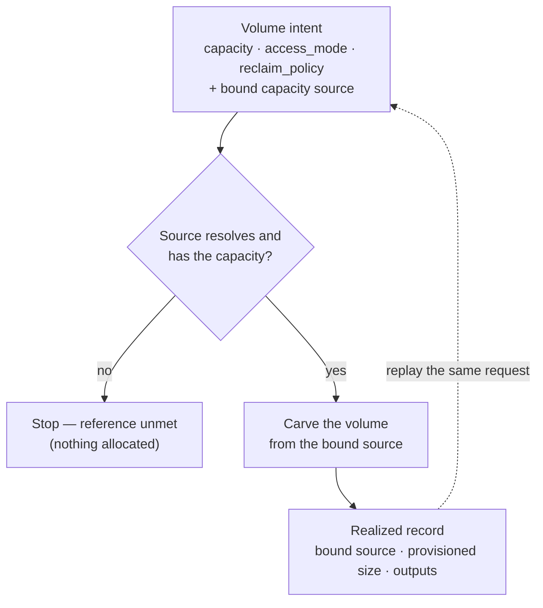

# UC-06 · Persistent volume bound to a pool — the stage

**What this settles:** the first case whose request names another resource. A `Volume` declares its capacity, access mode and reclaim policy, and binds to the capacity source it draws from. The storage provider carves it out, and the realized record publishes what was built. A **lighter** flow: it **builds on [request-realization](request-realization.md)** and documents only what this case adds.

> **Use Case:** `storage/provision-volume-bound-to-pool`. **Persona:** platform-engineer · **Profile:** standard.

**In one breath.** A platform engineer requests a persistent volume, the PVC-like unit an application consumes, with a size, an access mode and a reclaim policy. The volume names the pool it binds to; that pool is its single capacity source. The storage provider carves the requested size from it, honors the access mode and reclaim policy, and the volume reaches Realized with those properties readable from its record. The binding edge is first-class data, so the volume rehydrates by replaying the same request against the same pool.

## What this adds over request-realization
- **A reference in the payload.** The request binds to an existing capacity source. Placement and reserve must resolve and honor that reference, not just stand up an isolated resource.
- **Declared properties are the build instruction.** `capacity`, `access_mode` and `reclaim_policy` (`Retain` or `Delete`) are typed elements of `Volume`; the provider builds to them.
- **One capacity source.** In the class, the source is the `pool` edge (a `contained_by`) to the `StoragePool` the volume is carved from; it cannot outlive the pool, and its cluster derives from the pool's own `cluster` edge. A volume with no pool names its cluster directly (`provisioned_by`).
- **Read from the record, not the client.** The bound source and provisioned size are readable from the realized record and its outputs (`volume_handle`, `attached`, `accessible_from`), not inferred client-side.

## The flow — only what's different

Everything else (assemble, place, enrich, reserve, commit, converge) is request-realization.

## Success criteria (from the UC)
- The volume declares a `contained_by` edge to the pool it is carved from; the pool is its single capacity source.
- The provider carves the requested size from the bound pool and the volume reaches Realized.
- The declared access mode and retain policy are the realized properties, published on the volume's outputs.
- The bound-pool identity and provisioned size are readable from the volume's declared outputs, not inferred client-side.
- The volume rehydrates by replaying the same request against the same pool.

## Data · Policy · Provider
- **Data:** the `Volume` record (`capacity`, `access_mode`, `volume_mode`, `storage_class`, `reclaim_policy`), its binding edge, and the outputs on its realized record.
- **Policy:** system defaults only (`system_defaults_only`); no governance overlay in this case.
- **Provider:** the one eligible storage provider (`single_eligible`) carves the volume and reports the realized record.

## Who provides what, and when

The lifecycle answer — the personas, what a request contains, what data is added and **by whom**, why
**nobody sets placement**, and the worked VM-with-network-and-storage example — lives once in
[request-realization § Who provides what, and when](request-realization.md#who-provides-what-and-when).
It holds for every use case.

**This case's delta:** the driving persona is **`platform-engineer`**. Everything that persona relies on —
layers, tenant binding, policies, provider capability — was declared by the others *before* this
request existed, exactly as the lifecycle answer describes.

## Pointers
- Base flow: [request-realization](request-realization.md). UC source: `storage/provision-volume-bound-to-pool`.
- The `Volume` class: `registry/classes/resource/storage/volume/_base.yaml`.
