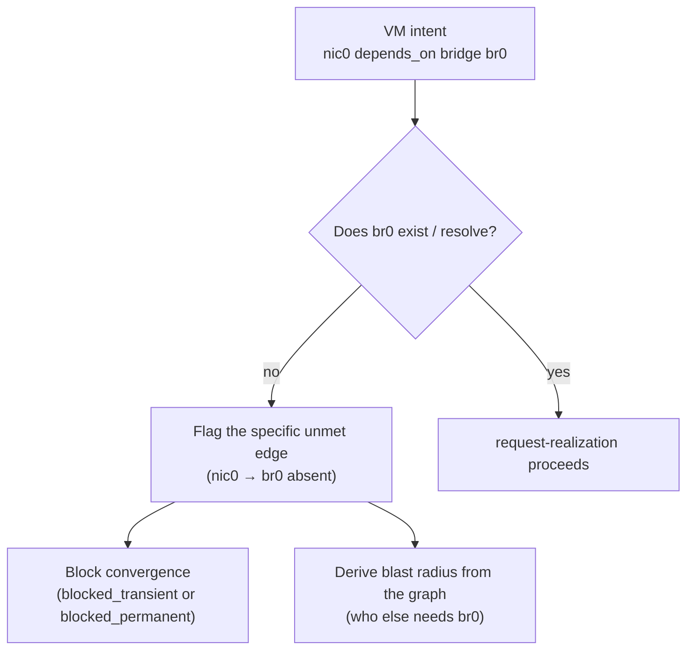

# UC-09 · Dependency failure surfaced — the stage

**What this settles:** a missing or misconfigured dependency is made **explicit and blocking** before implementation. The macvtap-versus-bridge class of failure surfaces as a named unmet edge, not a silent blackhole. A **lighter** flow: it **builds on [request-realization](request-realization.md)** and documents only what this case adds.

> **Use Case:** `intent-fulfillment/operational-dependency-cascade`. **Persona:** platform-engineer · **Profile:** standard.

**In one breath.** UC-08 orders good dependencies; this case handles the broken one. A VM's NIC declares `depends_on` a host bridge that does not exist. Instead of building a VM that quietly blackholes traffic, the control plane flags the *specific* unmet edge, blocks the VM's convergence until it is satisfied, and, from the same graph, reports the blast radius of the gap. The corpus record this flow cites is the container-and-PVC cascade, staged in full in [intent-fulfillment-operational-dependency-cascade](intent-fulfillment-operational-dependency-cascade.md); this flow applies the same mechanism to a VM and a bridge.

## What this adds over request-realization

- **The unmet edge is named.** Not "reserve failed" but "VM `nic0` depends_on bridge `br0`: absent". This is the `UnmetDependency` diagnostic of [ADR-010](../adr/ADR-010-dependency-graph-completion.md) (dependent, edge, severity, reach), and the clear-reason rule request-realization cites (DCM ADR-024, [§ Where the value comes from](request-realization.md#where-the-value-comes-from)) applied to a dependency rather than a field.
- **Blocking, not silent.** Convergence of the dependent VM halts until the bridge exists. The member is typed `blocked_transient` (the dependency can still clear) or `blocked_permanent` (it cannot). The failure surfaces before the blackhole, not after.
- **Impact is derivable.** The blast radius of the missing dependency comes from the UC-07 graph: what else waits on this bridge, what is at risk.

## The flow — only what's different

## Success criteria (from the UC)

- The dependent member is classified `blocked_transient` while its dependency is unrealized: not failed, not realized dangling.
- The missing dependency is classified as the root unsatisfied dependency, transiently unrealizable (converges later).
- Independent members with no dependency on it realize; the operational block is scoped to the directional chain.
- When the dependency realizes, the dependent converges automatically through the reconciliation loop, with no re-request.
- The consumer receives a warning naming the root, the reason, and the expected resolution, not only a structured field.

The corpus record states these for a container and a PVC. This flow's VM-and-bridge example exercises the first two and adds a blast-radius query over the graph. That added criterion is tracked as uncovered by the corpus record in [`docs/uc-scope-corpus-reconciliation.md`](../uc-scope-corpus-reconciliation.md).

## Data · Policy · Provider

- **Data:** the `depends_on` edge (UC-07) and its resolution state, resolved or unmet, with the target's identity; the `UnmetDependency` diagnostic.
- **Policy:** one validation (`single_validation`): an unmet hard dependency blocks; it is never auto-filled. The failure mode is `partial_fulfillment`: the rest of the intent proceeds.
- **Provider:** reports the bridge absent at reserve (`none_eligible` for that member); the control plane turns that into a named, blocking unmet edge rather than a runtime blackhole.

## Who provides what, and when

The lifecycle answer — the personas, what a request contains, what data is added and **by whom**, why
**nobody sets placement**, and the worked VM-with-network-and-storage example — lives once in
[request-realization § Who provides what, and when](request-realization.md#who-provides-what-and-when).
It holds for every use case.

**This case's delta:** the driving persona is **`platform-engineer`**. Everything that persona relies on —
layers, tenant binding, policies, provider capability — was declared by the others *before* this
request existed, exactly as the lifecycle answer describes.

## Pointers

- Base flow: [request-realization](request-realization.md). UC source: `intent-fulfillment/operational-dependency-cascade`.
- Edges and impact queries come from [UC-07](uc-07-udlm-dependency-graph-data-model.md); the happy-path ordering is [UC-08](uc-08-cross-provider-dependency-ordering.md). The nature-by-status permutations: [`docs/design/intent-fulfillment-model.md`](../design/intent-fulfillment-model.md).
