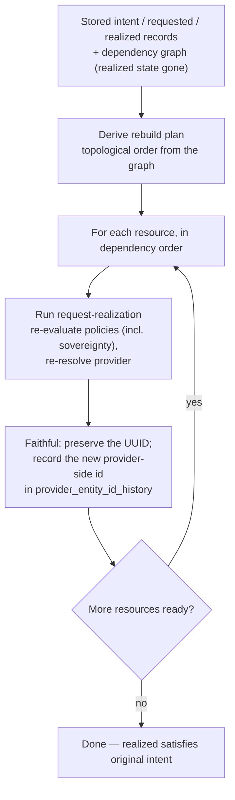

# UC-10 · Rehydration — rebuild from stored intent (the stage)

**What this settles:** how an environment is re-realized from **stored intent** after loss. The plan is
*derived* from the dependency graph, policies are re-evaluated, and providers are re-resolved as if fresh.
This is the UDLM-stage view of the operation the example implementation's how-to walks end to end
(`workload-migration-and-rehydration-example`, in the DCM repo). A **lighter** flow: it **builds on
[request-realization](request-realization.md)** and documents only what rehydration adds.

> **Use Case:** `cross-domain/dynamic-rehydration`. **Persona:** platform-engineer · **Profile:** standard.

**Three words, one act.** *Rehydration* is the **operation**: replay the stored intent, requested and realized
records against a target. *Rebuild* is its **mechanism**: the target stands up a fresh, native implementation
from that intent, never a lift-and-shift of the source construct. *Migration* is the **effect** the user sees:
the workload now runs on a new provider. **Migration and rehydration are the same operation with different
triggers:** a planned move (migration) versus a loss or DR event (rehydration). The pivot is **intent**.
Neither translates a source construct into a target one; both ask what the workload *needs* and let each
provider satisfy it natively. So there is no NSX-to-OVN conversion to fail: only the requirement
(`isolation: private`) is carried across, and the target realizes it its own way.

**In one breath.** Everything realized is gone; the stored intent records and the dependency graph survive.
The system reads that graph, derives a rebuild order on the spot, and runs request-realization for each
resource in dependency order. It re-evaluates validation policies (sovereignty included) and re-resolves
providers through the placement engine as it goes. When it finishes, the realized state satisfies the
original intent and every entity keeps its UUID.

**Identity: by mode (`RHY-005`, [four-states §5.2](../spec/foundations/four-states.md)).** The mode is set by
what survives:
- **Faithful (restore in place)**: the provider is still available. The entity **UUID is preserved**; only
  the provider-side identifier changes, recorded in `provider_entity_id_history`.
- **Provider-Portable (rebuild; the original is gone)**: a **new entity with a new UUID**, kept traceable to
  its predecessor by lineage (`rebuilt_from`, with `source_record_uuid` and `source_store`). Dependents are
  re-pointed to the new UUIDs as the graph replays. It is the same logical graph re-established, not the
  same identifiers.

This flow's scenario is **Faithful** (`rehydration_faithful`): the realized state is cleared, the providers
still stand, and UUIDs are preserved across the destroy-and-rebuild cycle. The Provider-Portable mode is
staged by [UC-18](uc-18-provider-portable-rebuild.md). Rehydration is transactional either way: a failed
target leaves the pre-rehydration state intact.

## What this adds over request-realization
- **Many implementations, ordered by the graph.** request-realization runs once per resource, sequenced by
  the stored dependency graph so dependencies come up before dependents. The per-resource flow is unchanged.
- **The plan is derived, not replayed.** There is no recorded action log to re-run. The order is computed
  from the graph at rebuild time, so a changed policy or a departed provider is honored automatically.
- **Policies re-evaluate per the estate's touch-trigger stance** (ADR-045 §8: adopt-on-touch, offer-on-touch,
  or provenance-until-explicit). Under the common adopt-current default, sovereignty and the other validation
  policies run again. `RHY-001`'s floor applies under every stance: tenancy, sovereignty and cross-tenant
  authorization always evaluate **current**. A pinned estate replays against its pinned revisions.
- **Identity by mode, lineage always.** Preserved on a Faithful restore; new but lineage-traced on a
  Provider-Portable rebuild (`RHY-005`). Either way the predecessor is resolvable from provenance, and the
  data model needs no separate rehydration-history structure.
- **Completeness is the bar.** Done when every resource in the original intent is realized and the realized
  state satisfies intent, not when a sequence "finished".

## The flow — only what's different

Everything inside each rebuild step is request-realization.

## Success criteria (from the UC)
- All resources are destroyed (realized state cleared) before rebuild.
- The system derives a rebuild plan from stored intent and the dependency graph.
- The plan is computed dynamically, not replayed from a recorded sequence.
- Validation policies (including sovereignty) are re-evaluated during rebuild; `RHY-001`'s floor stays current.
- Providers are resolved through the standard placement engine.
- All resources are re-realized in the correct dependency order.
- UUIDs are preserved across the destroy/rebuild cycle (`RHY-005`, Faithful mode).
- Post-rebuild realized state matches the original intent.

## Data · Policy · Provider
- **Data:** the stored intent, requested and realized records plus the dependency graph are the sole source
  of truth; identity resolves per the `RHY-005` mode.
- **Policy:** validation policies (sovereignty included) re-evaluate per the estate's declared touch-trigger
  stance (ADR-045 §8); adopt-current is the common default, not a platform imposition; `RHY-001` is always
  current.
- **Provider:** the placement engine re-resolves each resource; on a migration, a data-migration provider
  repopulates the data ([ADR-003](../adr/ADR-003-data-mobility-and-process-validation.md): data mobility).
  The control plane orchestrates the replay; UDLM contributes the stored records, the derived order, and the
  `RHY` invariants. In the example implementation (DCM) the replay also carries placement re-evaluation,
  leases and a `PENDING_REVIEW` pause.

## Who provides what, and when

The lifecycle answer — the personas, what a request contains, what data is added and **by whom**, why
**nobody sets placement**, and the worked VM-with-network-and-storage example — lives once in
[request-realization § Who provides what, and when](request-realization.md#who-provides-what-and-when).
It holds for every use case.

**This case's delta:** the driving persona is **`platform-engineer`**. Everything that persona relies on —
layers, tenant binding, policies, provider capability — was declared by the others *before* this
request existed, exactly as the lifecycle answer describes.

## Pointers
- Base flow: [request-realization](request-realization.md). Measured and validated by
  [UC-12](uc-12-rehydration-rto-measurement.md). Provider-Portable rebuild:
  [UC-18](uc-18-provider-portable-rebuild.md). End-to-end walkthrough in the example implementation: the
  DCM how-to `workload-migration-and-rehydration-example`. UC source: `cross-domain/dynamic-rehydration`.
