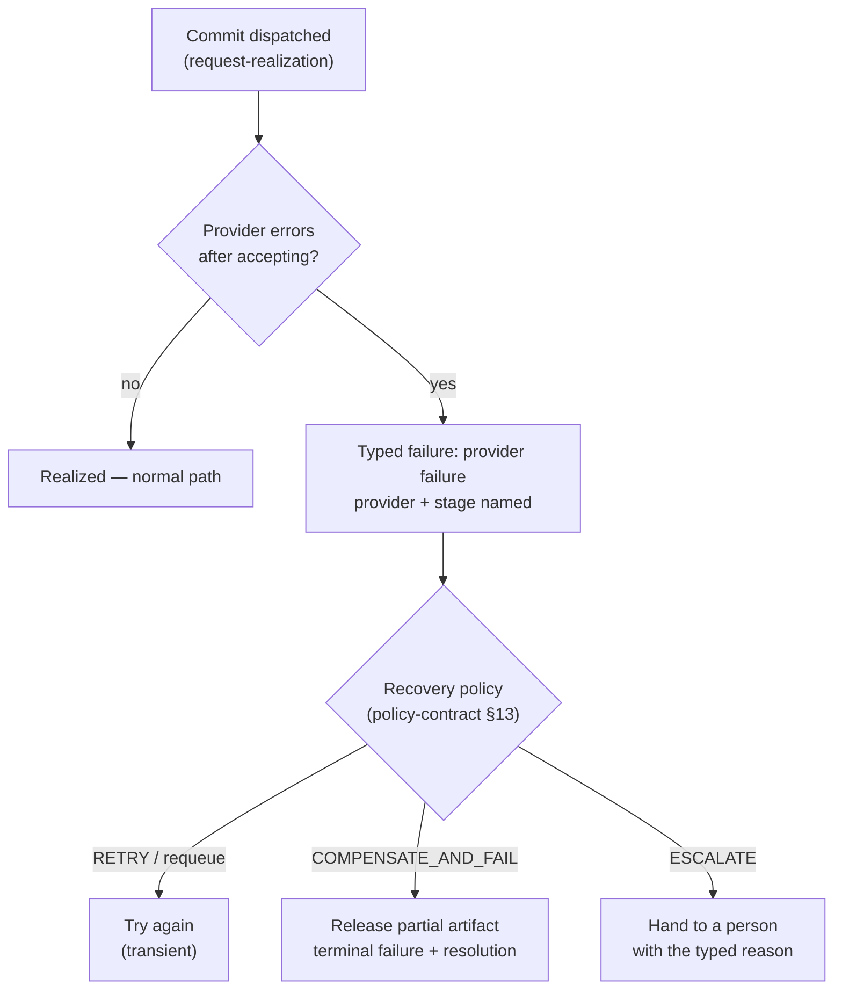

# UC-11 · Provider fails mid-provision — the stage

**What this settles:** what happens when a request validates and dispatches, and the chosen provider then
fails after accepting the work. The failure is **surfaced, typed and actionable**: the request reaches a
terminal failure state with a resolution, never sits Pending forever, and is never reported Realized over a
half-built VM. A **lighter** flow: it **builds on [request-realization](request-realization.md)** and
documents only what this case adds after commit begins.

> **Use Case:** `compute/vm-provision-provider-failure-refused`. **Persona:** platform-engineer · **Profile:** standard.

**In one breath.** Policy passes and the one eligible compute provider accepts the dispatch. Mid-provision the
backend errors, before the VM reaches Realized. The control plane drives the request to a typed terminal
failure: a *provider failure*, distinct from a capability mismatch (the provider was eligible and accepted)
and from a policy denial. The failure names the provider and the stage it failed at, carries a resolution the
requester can act on, and any partial artifact is reconciled, not left dangling.

## What this adds over request-realization
- **The base assumes commit succeeds; this doesn't.** Everything up to and including dispatch is
  request-realization. The new surface is after commit begins and the provider errors.
- **Bounded, not indefinite.** The request is never left Pending waiting on a provider that will not finish.
  The recovery conditions of [four-states §2.5](../spec/foundations/four-states.md) (`TIMEOUT_PENDING`,
  `INDETERMINATE_REALIZATION`, `COMPENSATION_IN_PROGRESS`, `COMPENSATION_FAILED`) are a `status.conditions`
  overlay; the lifecycle state itself never changes.
- **A typed failure, with a resolution.** The terminal state says *provider failure*, names the failing
  provider and the stage, and offers a resolution. A retryable transient is distinguishable from an
  unsatisfiable placement.
- **A recovery policy decides.** The recovery output of
  [policy-contract §13](../spec/contracts/policy-contract.md) picks the action (`RETRY`,
  `DISCARD_AND_REQUEUE`, `COMPENSATE_AND_FAIL`, `ESCALATE`, among others); the first matching recovery policy
  wins.
- **No orphaned state.** A partial provider artifact is reconciled or released (the release half of
  [ADR-011](../adr/ADR-011-validate-and-reserve.md)); the intent is never reported Realized when nothing
  usable exists.

## The flow — only what's different

Everything up to commit (assemble, place, enrich, reserve) is request-realization.

## Success criteria (from the UC)
- The request reaches a typed terminal failure state; it is never left Pending indefinitely awaiting a provider that will not finish.
- The failure is typed as a provider failure, distinct from a capability mismatch and from a policy denial.
- The intent is never reported Realized over a half-built VM; any partial provider artifact is reconciled, not left dangling.
- The failure names the failing provider and the stage it failed at, so a retryable transient is distinguishable from an unsatisfiable placement, and carries an actionable resolution.
- An audit record of the dispatch, the provider failure, and the offered resolution exists.

## Data · Policy · Provider
- **Data:** the typed terminal failure on the request (provider, stage, resolution), the `status.conditions`
  overlay while it is in flight, and the audit record.
- **Policy:** one validation before dispatch (`single_validation`); afterwards the recovery policy classifies
  the failure and chooses the action.
- **Provider:** the one eligible provider (`single_eligible`) accepts the dispatch and then fails; the failure
  mode is `provider_failure`.

## Who provides what, and when

The lifecycle answer — the personas, what a request contains, what data is added and **by whom**, why
**nobody sets placement**, and the worked VM-with-network-and-storage example — lives once in
[request-realization § Who provides what, and when](request-realization.md#who-provides-what-and-when).
It holds for every use case.

**This case's delta:** the driving persona is **`platform-engineer`**. Everything that persona relies on —
layers, tenant binding, policies, provider capability — was declared by the others *before* this
request existed, exactly as the lifecycle answer describes.

## Pointers
- Base flow: [request-realization](request-realization.md). UC source: `compute/vm-provision-provider-failure-refused`.
