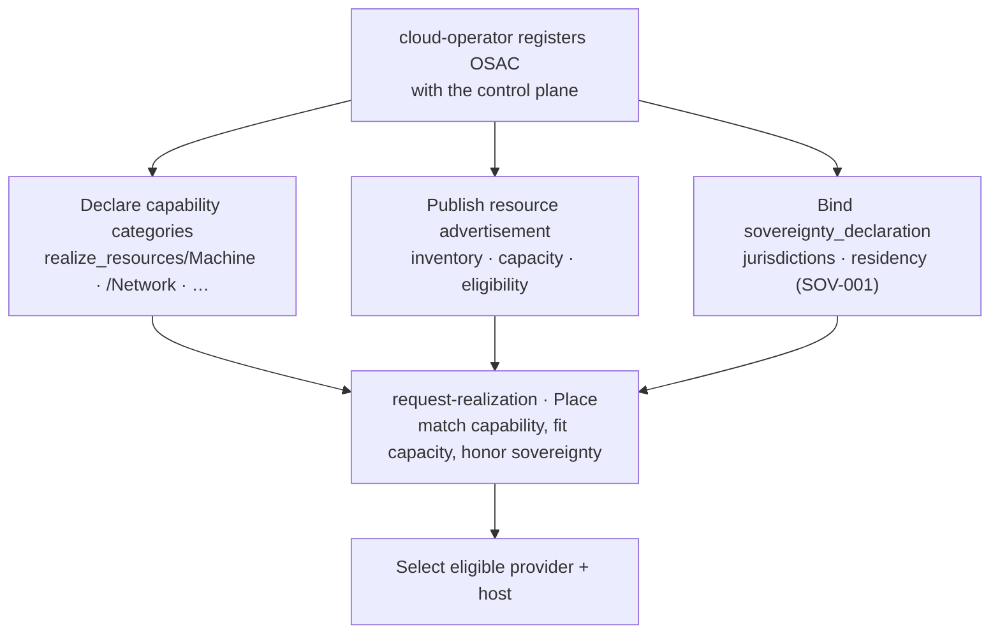

# UC-17 · Provider registration and capability advertisement — the stage

**What this settles:** how a provider becomes *eligible*. A cloud-operator registers a sovereign cloud (OSAC) by declaring, in portable terms, what it can realize, how much capacity it has, and the residency and jurisdiction guarantees it carries. Placement then has real capability and capacity to choose from, and never learns the cloud's native API. A **lighter** flow: it **builds on [request-realization](request-realization.md)** and documents only what this case adds.

> **Use Case:** `osac/cloud-provider-registration`. **Persona:** cloud-operator · **Profile:** sovereign.

**In one breath.** request-realization's Place step "narrows to the providers that fit"; this case is what makes a cloud *one of those providers*. The operator registers it, declares the capability categories it serves (`realize_resources/Machine`, `realize_resources/Network`, and so on), publishes a resource advertisement (inventory, per-host capacity, eligibility), and binds a `sovereignty_declaration` to it. All of that is recorded as data. Later, placement routes intent to this cloud on declared capability, not on hard-coded knowledge of it. Adding the cloud is additive: the substrate is unchanged and a new placement target appears.

## What this adds over request-realization

- **Registration precedes placement.** Before any request, the provider declares itself, its capabilities and its capacity ([provider-contract §2](../spec/contracts/provider-contract.md), registration). The base flow assumes eligible providers exist; this is how they come to exist.
- **Capability is declared, not inferred.** The provider names the categories it realizes, from the `provider-capability` taxonomy, so placement can match an intent to it.
- **Capacity and inventory feed selection.** The `resource_advertisement` of provider-contract §8.1a carries inventory, per-resource capacity (vcpu, memory, storage: total and free) and provider-declared eligibility. Placement picks a provider *and a host* with room. Capacity is refreshed by lifecycle events, not read from registration-time values.
- **Sovereignty is bound at registration.** `SOV-001` (provider-contract §2a) requires a `sovereignty_declaration` covering jurisdictions, legal frameworks and data-residency guarantees. The guarantees are declared and bound to the provider, not asserted out of band.
- **The native form stays at the edge.** The substrate records capability and sovereignty as data; the cloud's own API and vocabulary never enter it. Naturalization happens at the provider's edge, so the cloud stays swappable.

## The flow — only what's different

The Place step is request-realization's; this UC supplies what it selects over.

## Success criteria (from the UC)

- The cloud's capabilities are recorded as declared data, not inferred; placement will match on them.
- The advertised capacity is carried as data the platform can route against.
- The residency and jurisdiction guarantees are declared and bound to the provider, not asserted out of band.
- Registration adds a placement target without any change to the substrate or existing providers.
- The cloud's native format is nowhere in the substrate; naturalization is reserved to its edge.

## Data · Policy · Provider

- **Data:** the provider's registration record: capability categories, the resource advertisement, and the sovereignty declaration.
- **Policy:** several validations (`multi_validation`) under enforced sovereignty. The org's policy and the Governance Matrix resolve which advertised resources a tenant may select; the provider only declares.
- **Provider:** the registering cloud is the one eligible provider for this case (`single_eligible`); it advertises what it serves and how much room it has.

## Who provides what, and when

The lifecycle answer — the personas, what a request contains, what data is added and **by whom**, why
**nobody sets placement**, and the worked VM-with-network-and-storage example — lives once in
[request-realization § Who provides what, and when](request-realization.md#who-provides-what-and-when).
It holds for every use case.

**This case's delta:** the driving persona is **`cloud-operator`**. Everything that persona relies on —
layers, tenant binding, policies, provider capability — was declared by the others *before* this
request existed, exactly as the lifecycle answer describes.

## Pointers

- Base flow: [request-realization](request-realization.md); this UC feeds its **Place** step. UC source: `osac/cloud-provider-registration`.
- Registration (§2), sovereignty obligations (§2a) and resource advertisement (§8.1a): [`docs/spec/contracts/provider-contract.md`](../spec/contracts/provider-contract.md). The provider's side of the story: [provider-lifecycle](provider-lifecycle.md).
