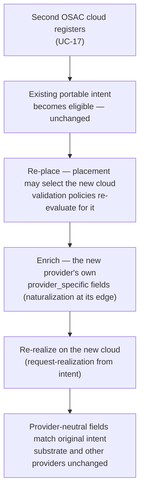

# UC-18 · Workload portability across providers — the stage

**What this settles:** that intent written in portable terms can land on a provider that did not exist when
it was written. A second sovereign cloud (OSAC) comes online and is offered as a provider alongside the first.
Existing intent becomes eligible for it with no change to the intent, the substrate, or the other providers;
the new cloud naturalizes at its own edge. A **lighter** flow: it **builds on
[request-realization](request-realization.md)** and documents only what this case adds.

> **Use Case:** `osac/provider-portability-new-cloud`. **Persona:** cloud-operator · **Profile:** sovereign.

**In one breath.** A cloud-operator registers a second OSAC cloud (UC-17). Placement now has two eligible
providers. Consumer intent that names no provider, namespace or native id is eligible for the new cloud as it
stands. A workload can be rebuilt onto it from the same declaration: placement selects the new provider,
enrichment adds that provider's own `provider_specific` fields, and the cloud turns portable intent into its
native form at its edge. The provider-neutral fields still match the original intent; nothing of the new
cloud's vocabulary enters the portable model.

## What this adds over request-realization
- **A new provider, no new intent.** The trigger is a provider being added, not a user request. The existing
  portable intent is already enough to place onto it.
- **Eligibility by capability.** Placement matches the intent's requirements against what the new cloud
  advertised at registration; the intent is not rewritten to fit the cloud.
- **Naturalization at the edge.** The old provider's `provider_specific` values, its Provider-Class elements
  ([ADR-038](../adr/ADR-038-scoped-resource-type-classes.md): Base, Type, Provider Class), cannot carry over.
  They are re-derived at enrichment for the new provider; the portable base is untouched. The record's
  `bound_providers` names which providers hold such data for the entity.
- **A rebuild is Provider-Portable.** Rebuilding the workload on the new cloud is the Provider-Portable mode
  of `RHY-005` ([four-states §5.2](../spec/foundations/four-states.md)): a new entity with a new UUID,
  traceable to its predecessor through `rebuilt_from`. Tenancy, sovereignty and cross-tenant authorization
  evaluate current (`RHY-001`, §5.3).
- **Portability is the proof.** Success is that the provider-neutral fields still match intent after the
  move, and that adding the cloud changed nothing else.

## The flow — only what's different

The re-realize step is request-realization, run with the new provider in the eligible set.

## Success criteria (from the UC)
- Existing portable intent becomes eligible for the new cloud with no change to the intent.
- Adding the cloud changes neither the substrate nor the other providers; it is additive.
- The new cloud naturalizes portable intent into its native form at its own edge.
- A workload can be rebuilt provider-portably onto the new cloud from the same declaration.
- No provider-native vocabulary from the new cloud enters the portable model.

## Data · Policy · Provider
- **Data:** intent is the source of truth; `provider_specific` references are re-derived while the portable
  base holds steady; the realized record on the new cloud carries its lineage.
- **Policy:** several validations (`multi_validation`) re-evaluate for the new provider under the sovereignty
  constraint; the move is governed, not blind.
- **Provider:** two eligible (`multiple_eligible`); the new cloud realizes from portable intent and
  naturalizes at its edge.

## Who provides what, and when

The lifecycle answer — the personas, what a request contains, what data is added and **by whom**, why
**nobody sets placement**, and the worked VM-with-network-and-storage example — lives once in
[request-realization § Who provides what, and when](request-realization.md#who-provides-what-and-when).
It holds for every use case.

**This case's delta:** the driving persona is **`cloud-operator`**. Everything that persona relies on —
layers, tenant binding, policies, provider capability — was declared by the others *before* this
request existed, exactly as the lifecycle answer describes.

## Pointers
- Base flow: [request-realization](request-realization.md). Registering the new cloud: [UC-17](uc-17-provider-registration-capability.md). Whole-environment rebuild in place: [UC-10](uc-10-dynamic-rehydration.md). UC source: `osac/provider-portability-new-cloud`.
